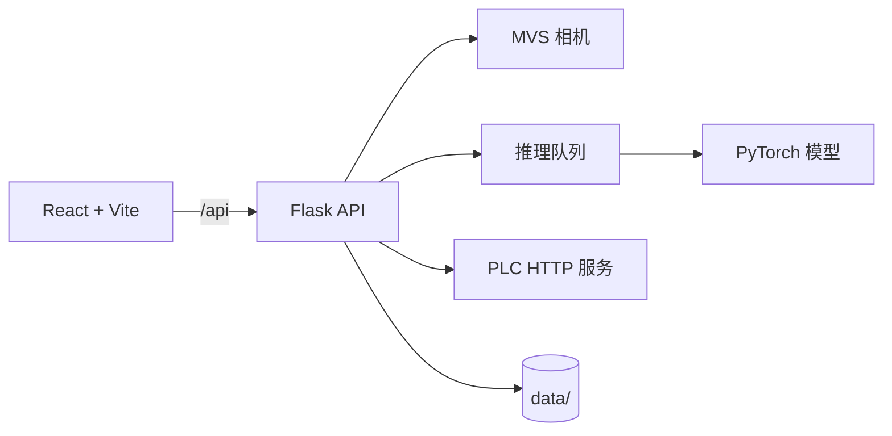

# 视界智检 V2.0：项目详细文档

本文档面向开发者、部署人员和维护人员，只描述系统实现、接口、配置和发布流程。现场操作请阅读[用户使用说明书](用户使用说明书.md)。

## 目录

1. [项目概览](#1-项目概览)
2. [运行架构](#2-运行架构)
3. [仓库结构](#3-仓库结构)
4. [后端实现](#4-后端实现)
5. [前端实现](#5-前端实现)
6. [模型与数据流](#6-模型与数据流)
7. [HTTP API](#7-http-api)
8. [配置与运行数据](#8-配置与运行数据)
9. [开发与构建](#9-开发与构建)
10. [发布检查](#10-发布检查)

---

## 1. 项目概览

### 1.1 系统职责

系统负责：

1. 初始化和管理工业相机；
2. 接收图像并提交推理队列；
3. 输出类别、置信度和统计结果；
4. 按相机配置保存检测照片；
5. 根据模型设置触发 PLC 写入；
6. 提供训练、测试和现场配置页面。

系统不包含：

- 海康 MVS SDK 的安装包和许可管理；
- PLC 服务端部署；
- 训练图片采集、标注和质量验收；
- 服务端级别的多用户鉴权系统。

### 1.2 技术栈

| 层 | 技术 |
| --- | --- |
| 后端 | Python、Flask、Flask-CORS |
| 相机 | 海康 MVS SDK、`MVSCameraManager` |
| AI | PyTorch、torchvision、MobileNetV3-Large |
| 图像 | Pillow、NumPy |
| 前端 | React 18、TypeScript、Vite、Zustand、Tailwind CSS |
| 桌面端 | Tauri 2、Rust |
| 发布 | PyInstaller、Tauri NSIS |

`requirements.txt` 保存通用运行依赖；`requirements-cpu.txt` 和 `requirements-gpu.txt` 分别声明 CPU/GPU AI 依赖。海康 MVS SDK 仍属于机器上的外部 SDK，不由 pip 安装。这样可以避免在 CPU 环境中误装 GPU 依赖，也让开发环境依赖入口更明确。

## 2. 运行架构

### 2.1 Web 模式



- Flask 默认监听 `0.0.0.0:5000`；
- Vite 默认监听 `0.0.0.0:5173`；
- Vite 将 `/api` 代理到 `VITE_BACKEND_URL`，默认值为 `http://127.0.0.1:5000`；
- Tauri 前端直接调用 `http://127.0.0.1:5000`。

### 2.2 Tauri 模式

Tauri 启动时通过 sidecar 启动打包后的 `backend.exe`，并注入 `VISION_DATA_DIR`。前端通过本机 HTTP API 调用后端，应用退出时清理后端进程。

### 2.3 后端后台任务

后端主要包含：

- 相机采集线程；
- 推理队列和推理 Worker；
- 异步照片保存 Worker；
- 定期照片清理线程；
- 异步模型训练线程。

启动时会尝试预加载和预热已有模型。模型缺失时会记录警告，并在需要时按模型加载。

## 3. 仓库结构

```text
.
├─ backend/
│  ├─ server.py                    Flask API 和服务启动
│  ├─ config.py                    参数、路径和训练配置
│  ├─ mvs_camera.py                海康 MVS 相机
│  ├─ mock_camera.py               测试辅助模拟相机
│  ├─ inference_worker.py          模型加载和推理队列
│  ├─ training.py                  数据集、训练和评估
│  ├─ plc_service.py               PLC 配置和写入
│  ├─ camera_config_manager.py     相机配置持久化
│  ├─ env_check.py                 环境检查
│  └─ logger.py                    日志
├─ view/
│  ├─ src/                         React 页面和业务组件
│  ├─ src-tauri/                   Tauri 壳和本地命令
│  ├─ scripts/                     sidecar 准备脚本
│  ├─ package.json                 前端命令和依赖
│  └─ vite.config.ts               Vite 构建和 API 代理
├─ docs/                           项目文档
├─ data/                            运行时数据，默认不提交
├─ build_*.ps1                     Windows 构建脚本
├─ backend.spec                    完整 PyInstaller 配置
├─ backend_cpu.spec                CPU-only PyInstaller 配置
├─ requirements.txt                通用 Python 运行依赖
├─ requirements-cpu.txt            CPU + AI 依赖
├─ requirements-gpu.txt            GPU + AI 依赖
└─ requirements*.txt               依赖入口
```

## 4. 后端实现

### 4.1 启动流程

入口为 `python -m backend`，最终调用 `backend.server.run_server()`。启动顺序如下：

1. 读取线体数量和设备配置；
2. 创建数据目录和相机照片目录；
3. 执行环境检测；
4. 初始化 MVS 相机管理器；
5. 预加载已有模型；
6. 启动推理、保存和照片清理任务；
7. 启动 Flask HTTP 服务。

### 4.2 核心模块

| 文件 | 职责 |
| --- | --- |
| `config.py` | 服务端口、相机数量、训练参数、照片策略和运行路径 |
| `server.py` | Flask 应用、API 路由和系统生命周期 |
| `mvs_camera.py` | 相机发现、初始化、采集、触发和释放 |
| `inference_worker.py` | 模型加载、预热、设备选择、队列和结果 |
| `training.py` | 数据集扫描、训练、验证、保存和分类 |
| `plc_service.py` | PLC 配置、HTTP 写入和测试 |
| `camera_config_manager.py` | 相机配置的读取和持久化 |
| `env_check.py` | Python、PyTorch、CUDA、MVS 和硬件检查 |
| `logger.py` | 日志格式和日志输出 |

### 4.3 设备选择

推理和训练设备分别保存，支持：

- `cpu`：始终可用；
- `cuda`：仅在 PyTorch 检测到 CUDA 时可用。

设备配置写入 `data/device_config.json`，后端启动时加载。

## 5. 前端实现

### 5.1 页面组成

固定页面由 `view/src/components/layout/TabBar.tsx` 定义：

| 页面 | 主要组件 | 职责 |
| --- | --- | --- |
| 运行 | `RunTab.tsx` | 实时画面、启停、布局、统计和相机详情 |
| 文件 | `FileTab.tsx` | 产品、线体和分配关系 |
| 设置 | `SettingsTab.tsx` | 设备、相机、照片和训练入口 |
| 模型设置 | `ModelSettingsTab.tsx` | 类别说明和 PLC 剔除类别 |
| 测试 | `TestTab.tsx` | 模型测试和推理计时 |
| 用户 | `UserTab.tsx` | 账户和权限管理 |
| PLC | `PlcTab.tsx` | PLC 参数和写入测试 |
| 说明书 | `HelpTab.tsx` | 内置帮助 |

### 5.2 状态、服务和持久化

- `store/useAppStore.ts`：全局 UI、登录、运行和弹窗状态；
- `services/api.ts`：前端到 Flask 的 HTTP API 封装；
- `services/native.ts`：Tauri 原生命令、目录选择和独立窗口；
- `services/storage.ts`：用户、产品、线体、布局、照片和设置；
- `services/permissions.ts`：页面和操作权限判断。

浏览器模式使用 `localStorage`。Tauri 模式通过 Rust 命令保存到应用数据目录，文件使用项目内置的加密封装。

### 5.3 前端权限

| 级别 | 页面范围 |
| --- | --- |
| 管理员 | 全部页面和管理操作 |
| 技术员 | 除“用户”外的页面和设置 |
| 操作员 | “运行”页面 |
| 未登录 | “运行”和“说明书”，受保护操作需要登录 |

该权限体系由前端实现，不等同于服务端鉴权。部署到不可信网络时必须通过网络隔离、防火墙或反向代理限制访问。

## 6. 模型与数据流

### 6.1 训练模型

- 主干：预训练 MobileNetV3-Large；
- 输入尺寸：224×224；
- 预处理：PIL 加载、缩放、裁剪/填充和张量归一化；
- 数据增强：翻转、旋转、颜色扰动、仿射和透视；
- CUDA 训练：支持 AMP；
- 输出：类别标签、置信度和耗时。

### 6.2 数据集约定

```text
<类别根目录>/
├─ 类别A/
│  ├─ image-001.jpg
│  └─ image-002.png
├─ 类别B/
│  └─ image-003.bmp
└─ 类别C/
   └─ image-004.jpeg
```

类别子目录名称会成为模型标签和模型设置中的 PLC 匹配键。训练前应保证类别名称稳定且每个有效目录包含图片。

### 6.3 检测链路

```text
相机采集
  → 帧获取
  → 提交推理队列
  → 模型准备/预处理
  → 模型调用
  → 类别与置信度
  → 统计和 PLC 输出
  → 异步照片保存
```

### 6.4 测试计时

测试页面显示真实异步链路的阶段耗时，包括队列等待、模型准备、预处理、模型调用、识别、结果交接、结果输出和照片保存。该数据用于工程分析，不直接代表整条生产线的节拍承诺。

## 7. HTTP API

后端默认 API 前缀为 `/api`，端口为 `5000`。

### 7.1 系统和环境

| 方法 | 路径 | 作用 |
| --- | --- | --- |
| GET | `/api/health` | 健康检查 |
| GET | `/api/env-check` | 环境检查 |
| GET | `/api/hardware` | 硬件、CUDA、磁盘和网络信息 |
| GET/POST | `/api/settings/line-count` | 读取/修改线体数量 |
| GET/POST | `/api/settings/device` | 读取/修改训练和推理设备 |

### 7.2 相机和运行

| 方法 | 路径 | 作用 |
| --- | --- | --- |
| GET | `/api/cameras` | 相机列表和状态 |
| GET | `/api/cameras/mapping` | 相机/线体映射 |
| GET | `/api/cameras/config` | 全部相机配置 |
| GET/POST | `/api/cameras/config/<cam_id>` | 单相机配置 |
| POST | `/api/start` | 启动系统或指定相机 |
| POST | `/api/lines/<cam_id>` | 启用/停用线体 |
| POST | `/api/stop` | 停止系统 |
| GET | `/api/status` | 运行状态、结果和统计 |
| GET | `/api/frame/<cam_id>` | 获取最新帧 |
| GET | `/api/result/<cam_id>` | 获取最近结果 |
| GET | `/api/stats` | 获取统计 |
| POST | `/api/stats/reset/<cam_id>` | 重置统计 |

### 7.3 照片和文件

| 方法 | 路径 | 作用 |
| --- | --- | --- |
| GET | `/api/image-directories` | 列出后端可见图片目录 |
| GET | `/api/save-settings` | 获取照片保存设置 |
| POST | `/api/save-settings/<cam_id>` | 保存单相机照片设置 |
| GET | `/api/photos/<cam_id>` | 列出照片 |
| GET | `/api/photos/<cam_id>/<filename>` | 获取照片 |
| DELETE | `/api/photos/<cam_id>/<filename>` | 删除照片 |
| POST | `/api/photos/cleanup` | 执行照片清理 |

### 7.4 模型和训练

| 方法 | 路径 | 作用 |
| --- | --- | --- |
| GET | `/api/models` | 列出模型 |
| POST | `/api/models/<model_name>/settings` | 保存类别说明和剔除类别 |
| POST | `/api/test` | 有标签/无标签测试 |
| POST | `/api/training/start` | 启动训练 |
| GET | `/api/training/status` | 获取训练进度 |
| POST | `/api/training/stop` | 停止训练 |
| GET | `/api/training/history` | 获取训练历史 |

### 7.5 PLC

| 方法 | 路径 | 作用 |
| --- | --- | --- |
| GET/POST | `/api/plc/config` | 读取/保存 PLC 配置 |
| POST | `/api/plc/test` | 测试 PLC 写入 |
| POST | `/api/cameras/<cam_id>/plc/test-reject` | 测试相机剔除信号 |

当前 API 没有独立的服务端用户鉴权层，部署时应限制网络访问范围。

## 8. 配置与运行数据

### 8.1 环境变量

| 变量 | 默认值 | 作用 |
| --- | --- | --- |
| `VISION_FLASK_HOST` | `0.0.0.0` | Flask 监听地址 |
| `VISION_DATA_DIR` | 按运行模式决定 | 覆盖后端数据目录 |
| `VITE_BACKEND_URL` | `http://127.0.0.1:5000` | Vite 代理目标 |
| `VISION_PORTABLE` | 未设置 | 便携版使用程序目录下 `data/` |

### 8.2 数据目录

```text
data/
├─ captures/cam1..camN/       相机照片
├─ *_classifier_*.pth         模型
├─ camera_config.json          相机配置
├─ plc_config.json             PLC 配置
├─ device_config.json          设备配置
├─ line_count.json             线体数量
├─ backend_config.json         后端配置
├─ training_history.json       训练历史
└─ vision_system.log           日志
```

数据目录已被 `.gitignore` 忽略。迁移设备时只备份必要配置和模型，不要把现场图片、PLC 地址、账号密码和日志提交到公共仓库。

### 8.3 照片清理

后端默认按 `Config` 中的策略清理照片：最大保留时间 30 天、每个相机最多 1000 张，清理间隔 3600 秒。现场如有长期留存需求，应建立外部归档流程。

## 9. 开发与构建

### 9.1 常用命令

```powershell
# 后端：项目根目录
python -m backend

# 前端：view 目录
npm ci
npm run web:dev
npm run build
npm run preview
```

`npm run build` 会先执行 TypeScript 检查，再执行 Vite 生产构建。

### 9.2 构建脚本

| 脚本 | 产物 |
| --- | --- |
| `build_portable_tauri.ps1` | CPU-only Tauri 便携版 |
| `build_installer_cpu.ps1` | CPU-only NSIS 安装包 |
| `build_portable_tauri_full.ps1` | 完整依赖 Tauri 便携版 |
| `build_installer_tauri_full.ps1` | 完整依赖 NSIS 安装包 |

CPU-only 构建会使用 `.venv_cpu`，构建后检查产物中是否包含 CUDA DLL。

### 9.3 构建步骤

1. 准备 Python、Node.js、Rust/Cargo 和依赖；
2. 构建 React/Vite 前端；
3. 使用 PyInstaller 构建后端；
4. 将后端复制到 Tauri resources；
5. 执行 `tauri:prepare` 准备 sidecar；
6. 构建 Tauri 可执行文件或 NSIS 安装包；
7. 将最终产物整理到 `releases/`。

## 10. 发布检查

### 10.1 自动检查

```powershell
cd view
npm run build
cd ..
git diff --check
git status --short
```

### 10.2 现场验证

至少验证：

- 无 MVS SDK 或相机未连接时的错误提示；
- 无模型和 CUDA 不可用时的降级行为；
- PLC 不可达时的报警和日志；
- Web 局域网访问；
- 单相机启停；
- 照片保存和清理；
- 训练停止和训练失败；
- Tauri 退出时后端进程清理。

### 10.3 开源发布

- 不提交 `data/`、图片、模型、日志、账号和现场 PLC 配置；
- 不提交 `.venv/`、`.venv_cpu/`、`view/node_modules/` 和构建产物；
- 核对 MVS SDK、PyTorch、模型权重和第三方资源的许可证；
- 在仓库根目录补充完整的 `LICENSE` 文件；
- 对外发布前确认 README 中的启动命令和发布版本一致。
